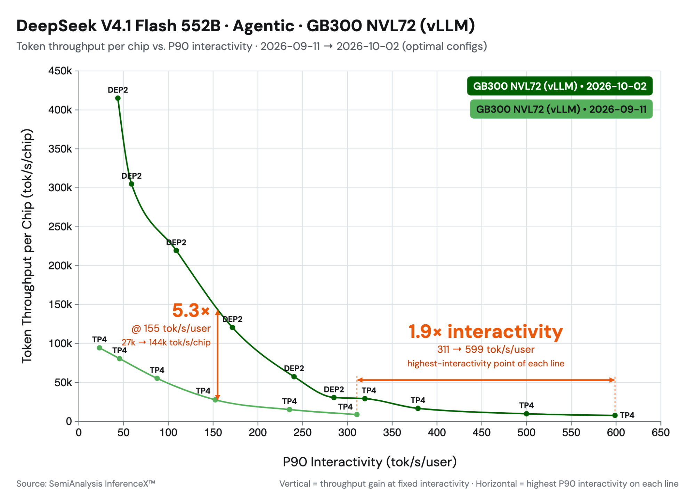
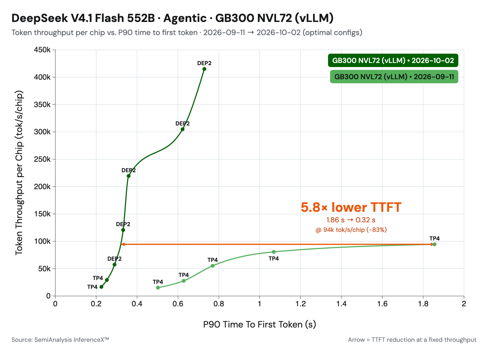

> 译注:本文译自 vLLM 官方博客 *DeepSeek-V4.1-Flash on vLLM: 5x Agentic Throughput Since Day 0*(2026-10-07)。专有名词(prefill、decode、TTFT、KV cache、rank 等)在首次出现时给出中文,部分保留英文原词以便对照。

*图 1:从模型发布首日(day 0)到 10 月 2 日,vLLM 在 SemiAnalysis AgentX 上的结果([来源](https://inferencex.semianalysis.com/inference/deepseek-v41-flash?i_seq=agentic-traces&i_xmode=interactivity&g_model=DeepSeek-V4.1-Flash&i_gpus=gb300_vllm&i_dstart=2026-09-11&i_dend=2026-10-02&i_metric=y_tpPerGpu))。*

**TL;DR:** 在 DeepSeek-V4.1-Flash 发布后的三周里,Inferact 与 vLLM 社区对该模型做了优化,在低并发下取得 1.9× 的加速,在 150 TPS 约束下取得 5.3× 的吞吐提升。性能提升来自:

- 我们实现了配合 CUDA graph 的 SWA 有界重放(bounded replay),使 TTFT 降低约 30%。

- 我们集成了 DeepSeek 新发布的内核,包括 MegaAttention、Mega-mHC、Mega-Gate 和 DeepSelect。

- 我们对其余内核做了激进的融合与并行化,包括 mHC 旁路流(side stream),并把 all-reduce 与其前后的算子融合成单个内核。

DeepSeek V4.1 为长程智能体(agentic)服务任务引入了一种高效的架构:借助因果编码器-解码器(causal encoder-decoder,CED)架构,模型在解码(decode)时每个 token 激活 16B 参数,而在预填充(prefill)时只激活 8B 参数。该模型的内存效率也极高。它组合了多种技术来压缩 KV 缓存大小:压缩稀疏注意力 2(Compressed Sparse Attention 2,CSA2)、FP4 KV 缓存,以及层间 KV 缓存共享,把全局 KV 的占用压到每 token 890 字节。本文展示我们如何把 DeepSeek 的这些模型层优化与 vLLM 侧的系统优化结合起来,在 SemiAnalysis AgentX 智能体服务基准上实现 5× 吞吐。我们把优化分成两类来介绍:SWA 有界重放,以及与内核相关的优化。

## SWA 有界重放

DeepSeek-V4.1-Flash 保存两种 KV 缓存。全局 KV 是压缩过的、跨层共享的,并以 FP4 存储,每 token 约 890 字节([V4.1 技术报告](https://huggingface.co/deepseek-ai/DeepSeek-V4.1-Flash/blob/main/DeepSeek_V41_Tech_Report.pdf))。滑动窗口(SWA)KV 则是未压缩的 FP8,覆盖 40 层中每一层的最后 128 个位置。

SWA KV 带来两项开销:

1. 前缀缓存(prefix caching)必须在每一个可能的命中边界都存一份,存储开销是全局 KV 的 10 倍以上。

1. 预填充要在每个 prompt token 上运行第 21–39 层,而解码只读取它们最后 128 个位置。

一种直接的办法是重新计算 SWA KV 而不是缓存它。但精确重算代价很高,因为每一层的 128-token 窗口都依赖于下一层中更早的位置,所以在 L 层上重建它,大约要重放 L × 128 个 token。

DeepSeek V4.1 引入了 SWA 有界重放,以精确性换效率。它只重跑最后 128 个 token,并把 SWA 窗口在重放起点处截断。结果不是逐位精确的,但 DeepSeek 报告质量损失可以忽略(详见下文)。vLLM 在两处应用它,各对应一项开销。

<iframe class="vllm-embed" src="/assets/interactive_pages/dsv41-swa-replay.html" title="SWA 有界重放:前缀命中后的精确重建 vs. 有界重放" loading="lazy" scrolling="no" style="display: block; width: 100%; height: 720px; border: 0; overflow: hidden;"></iframe>

*图 2:精确重建会逐层级联,每层多回溯一个窗口。有界重放只重算最后一个窗口,并在重放起点 s 处截断。可逐步演示,或[全屏打开](/assets/interactive_pages/dsv41-swa-replay.html)。*

### 编码器侧:缓存命中时重建窗口

采用编码器侧重放后,vLLM 只缓存全局 KV,跳过 SWA KV。当前缀命中长度为 H 时,它重跑 token [H − 128, H) 来重建 SWA KV,窗口在 s = H − 128 处截断。

### 解码器侧:跳过大部分 prompt 预填充

在 DeepSeek V4.1 的 CED 架构中,第 20 层计算解码器的全局 KV,第 21–39 层复用它。因此 vLLM 在每个 token 上运行第 20 层以产生该全局 KV,而第 21–39 层只在每个请求的最后 128 个 token 上运行。对于长 prompt,这相当于跳过了将近一半的模型。

<iframe class="vllm-embed" src="/assets/interactive_pages/dsv41-swa-decoder.html" title="解码器侧 SWA 有界重放:第 21–39 层只在最后 128 个 token 上运行" loading="lazy" scrolling="no" style="display: block; width: 100%; height: 720px; border: 0; overflow: hidden;"></iframe>

*图 3:在解码器中,只有第 20 层的全局 KV 需要对每个 token 计算。第 21–39 层只在最后 128 个 token 上运行。可逐步演示,或[全屏打开](/assets/interactive_pages/dsv41-swa-decoder.html)。*

### 为裁剪后的层使用 CUDA graph

裁剪之后,第 21–39 层的 GPU 工作量非常小,如果以 eager 方式运行,内核启动(launch)开销会占主导,GPU 反而闲着。它们的输入形状也与第 0–20 层不同,所以这两部分无法被捕获进同一个 CUDA graph。vLLM 的可断开 PIECEWISE graph 本来就在模型中部断开,这提供了一个天然的切分点:第 0–20 层在完整 batch 上捕获,第 21–39 层在裁剪后的 batch 上单独捕获。这使得 CUDA graph 可用于裁剪后的预填充,并让第 21–39 层使用自己的捕获尺寸,以获得更好的 graph 覆盖率。

SWA 有界重放对 DeepSeek-V4.1 默认开启,由 `--[no-]swa-bounded-replay` 控制。

### 精度与性能结果

虽然 SWA 有界重放并不精确,但 DeepSeek 报告其质量损失可以忽略。我们在 vLLM 中用 GSM8K、GPQA 等基准做了确认,没有观察到有意义的精度差异(差距在约 1.5 个标准误以内)。

性能方面,编码器侧是用每次命中多跑一个窗口的预填充来换缓存空间,所以加速来自解码器侧。我们在三种设置下测量单请求预填充 TTFT:关闭重放;开启重放但不使用解码器 CUDA graph(第 21–39 层以 eager 方式运行,且只有 eager 步骤被裁剪);开启重放并使用解码器 CUDA graph。

<iframe class="vllm-embed" src="/assets/interactive_pages/dsv41-prefill-ttft.html" title="NVIDIA GB200 上开启 SWA 有界重放的预填充 TTFT" loading="lazy" scrolling="no" style="display: block; width: 100%; height: 720px; border: 0; overflow: hidden;"></iframe>

*图 4:DeepSeek-V4.1-Flash 在 SWA 有界重放关闭与开启、使用与不使用解码器 CUDA graph 时的单请求预填充 TTFT(毫秒)。NVIDIA GB200 上 3 次运行的中位数,前缀缓存关闭。百分比相对于关闭重放(越低越好)。鼠标悬停在柱子上可看 TTFT 绝对值,或[全屏打开](/assets/interactive_pages/dsv41-prefill-ttft.html)。*

**解码器重放配合 CUDA graph 可将预填充计算时间削减 30–40%。** CUDA graph 对短 prompt 最重要,因为此时内核启动是瓶颈:没有它,启动开销超过了 GPU 上省下的时间,重放反而比基线更慢(DEP2 上 1K 时最多 +12%)。对于长 prompt,GPU 工作量足够大,可以掩盖启动开销,所以 eager 重放已经拿到了大部分收益,CUDA graph 再多贡献几个百分点。

## 内核

DeepSeek 在发布 DeepSeek-V4.1-Flash 的同时,在它的三个代码仓库里发布了新内核。DeepSelect 是面向 DeepSeek 稀疏注意力的一个新 top-k 库。DeepGEMM 新增了稀疏索引器(indexer)内核和若干与 GEMM 相关的融合内核。FlashMLA 新增了 NVFP4 KV 缓存支持和一个融合注意力内核 MegaAttention。我们已经把其中多个开源内核集成进 vLLM,并在 [#57448](https://github.com/vllm-project/vllm/issues/57448) 中跟踪进展。

<iframe class="vllm-embed" src="/assets/interactive_pages/dsv41-kernel-fusion.html" title="DeepSeek-V4.1 解码路径上的内核融合" loading="lazy" scrolling="no" style="display: block; width: 100%; height: 720px; border: 0; overflow: hidden;"></iframe>

*图 5:DeepSeek-V4.1 的单层前向过程。金色轮廓标出内核融合及其对应的 vLLM PR。可逐步查看低延迟路径和高吞吐路径,点击 FULL LAYER 查看整层,或[全屏打开](/assets/interactive_pages/dsv41-kernel-fusion.html)。*

**Mega-mHC([#56962](https://github.com/vllm-project/vllm/pull/56962))。** Mega-mHC 把 mHC 链融合成一个内核:post 步骤、延迟的 pre 步骤(delayed-pre)以及 RMSNorm。它取代了原有的 TileLang 融合路径,DeepGEMM 的实现现在已经超过了后者。在 NVIDIA GB200 上,该内核比 TileLang 版本快 1.14–1.51×。

**Mega-Gate([#56266](https://github.com/vllm-project/vllm/pull/56266))。** Mega-Gate 把 MoE 路由器(gate GEMM、专家打分、偏置和 top-k 选择)融合成一个内核。此前这些操作是一次 GEMM 加一个独立的 top-k 内核,多付出一次内核启动,以及分数在内存中的一次往返。这项融合在中等 batch 大小下带来 1.18–1.31× 的内核加速。

**mHC 多流重叠(multistream overlap)([#57603](https://github.com/vllm-project/vllm/pull/57603))。** 在 V4.1 中,mHC 系数被平移了一个子层,所以下一个接缝处的系数 GEMM 只读取在注意力或 FFN 运行之前就已存在的残差流。在下一次 post/pre 步骤把二者合并之前,任何一方都不需要对方的输出。在小 batch 下,vLLM 现在把下一个 mHC 块的系数放到一条旁路 CUDA stream 上计算,与注意力和 FFN 并行。这把原本落在延迟受限解码关键路径上的工作隐藏了起来。在 TP4 低延迟场景下,这使延迟降低约 4%。

**稀疏 MQA logits([#56254](https://github.com/vllm-project/vllm/pull/56254))。** 在 V4.1 中,靠后的索引器层从一个固定的 16K 候选位置集合中选取 top-k。以前的实现是对整个上下文计算分数,并在打分前屏蔽所有非候选块。DeepGEMM 的稀疏内核只对候选打分,因此开销不再随上下文增长。在 NVIDIA GB300 上按单层计,8K token 时快 1.2×,512K 时快 14–23×。在 4× NVIDIA GB300 上端到端来看,解码提升 3–6%;预填充在 512K 上下文时快 1.43×,在 1M 上下文时快 2×。

**支持 NVFP4 压缩 KV 的 MegaAttention([#56935](https://github.com/vllm-project/vllm/pull/56935))。** FlashMLA 的 MegaAttention 内核在一次启动中完成查询 RoPE、稀疏注意力、对输出做逆 RoPE 以及 FP8 转换,直接写入输出投影所读取的缓冲区。这消除了注意力与下一层之间的独立内核和内存往返。它还能读取一种新的 NVFP4 压缩 KV 格式,比之前的 FP8 KV 缓存小 45%。MegaAttention 还通过激进的融合消除了算子之间的 HBM 写入,把内核效率提升了 1.45×。

**低延迟融合 WO-A 内核([#58634](https://github.com/vllm-project/vllm/pull/58634))。** 针对 Blackwell 上的小解码 batch,我们把逆 RoPE、FP8 量化、WO-A batch GEMM 以及 MXFP8 再量化融合进单个 CuTe-DSL 内核,把 WO-B 之前的链路从三个内核减为一个。核心思路是让中间激活值留在片上,并把数据搬运与计算流水化,避免在小 batch 下占主导的额外内核启动和全局内存往返。这使融合后的 WO-A 路径最多提速约 2.1×,并在低并发下使 token 间延迟(inter-token latency)最多降低约 6–7%。

**Engram。** V4.1 的 Engram 层从两张大型 FP8 表中查找行,键是哈希后的 token n-gram。每一步只读取少量行,所以表的放置位置和查找延迟比计算更重要。我们对卸载到 CPU 的 Engram 查找做异步预取,让主机内存访问与解码器计算重叠,以加速小 batch 解码([#56512](https://github.com/vllm-project/vllm/pull/56512))。Engram 头采用统一的 TP/DP 方案分片,同机部署的 DP 副本共享同一份主机表,避免了冗余拷贝以及查找路径上的任何 DP 通信([#57651](https://github.com/vllm-project/vllm/pull/57651))。针对这些驻留在主机上的大表,我们还支持透明大页(THP)以降低缺页开销,使预填充的查找内核最多快 10×([#56926](https://github.com/vllm-project/vllm/pull/56926))。我们也为可用大页不足的情况加入了优化([#59327](https://github.com/vllm-project/vllm/pull/59327))。

## 智能体性能

我们用 SemiAnalysis AgentX 基准作为有代表性的智能体服务负载来衡量性能(详见我们的[上一篇文章](https://vllm.ai/blog/2026-09-08-vllm-agentx))。这些优化合在一起,使 vLLM 相比我们首日的实现有了显著的性能提升。如图 6 所示,我们的低延迟结果比首日结果提升 1.9×,高吞吐结果提升约 5×。

*图 6:从模型发布首日到 10 月 2 日,vLLM 在 SemiAnalysis AgentX 上的结果([来源](https://inferencex.semianalysis.com/inference/deepseek-v41-flash?i_seq=agentic-traces&i_xmode=interactivity&g_model=DeepSeek-V4.1-Flash&i_gpus=gb300_vllm&i_dstart=2026-09-11&i_dend=2026-10-02&i_metric=y_tpPerGpu))。*

对于低延迟服务,我们使用 TP4 配合 FlashInfer 注意力。小 batch 解码主要受内存带宽限制,所以把模型权重分片到四块 GPU 上很合适。我们也试过 MegaAttention,但它的主要优势在更高吞吐的场景,那里融合有更大的发挥空间。在 TP4 下这一收益小得多,在我们的测试中 FlashInfer 最终更快。

对于高吞吐,我们切换到 DEP2,使用 DP 注意力并把专家拆分到各 GPU 上。由于 V4.1 在所有注意力头之间使用共享的 KV 隐变量(latent),TP 会让 KV 缓存在各 GPU 上重复一份。DP 避免了这种重复:每块 GPU 只为它服务的请求存储 KV,并通过会话亲和性(session affinity)在多轮之间保持前缀缓存的局部性。MegaAttention 借助 NVFP4 进一步削减了每请求的 KV 占用,相比 FP8 几乎减半,从而提高了单 GPU 并发。

值得注意的是,V4.1 的内存效率很高,在整个基准测试中都不需要 KV 缓存卸载(offloading)。我们预计在采用 P/D 分离、并发更高时,KV 缓存卸载才会开始发挥作用。

SWA 有界重放加上预填充侧的内核优化,也大幅改善了 TTFT。

*图 7:优化后的 TTFT 与吞吐的关系([来源](https://inferencex.semianalysis.com/inference/deepseek-v41-flash?i_seq=agentic-traces&i_xmode=ttft&g_model=DeepSeek-V4.1-Flash&i_best=0&i_gpus=gb300_vllm&i_metric=y_tpPerGpu&i_dstart=2026-09-11&i_dend=2026-10-02))。*

图 7 展示了优化后的 TTFT–吞吐权衡。在约 100K 吞吐处,三项优化合力使 TTFT 下降近 70%:

- SWA 有界重放让模型的上半部分只处理最后 128 个 token,把预填充计算量削减约一半。

- CUDA graph 让裁剪后的小规模重放在 GPU 上保持高速,而不是受限于 CPU 的内核启动,所以我们能拿到完整的加速。

- 内核改进加速了模型计算本身。

## 致谢

我们感谢 DeepSeek 开源 DeepSeek-V4.1-Flash 及相关内核,感谢 Inferact 团队完成最初的模型适配与优化,感谢 NVIDIA 的协作与支持,感谢 SemiAnalysis 提供 AgentX 基准。

