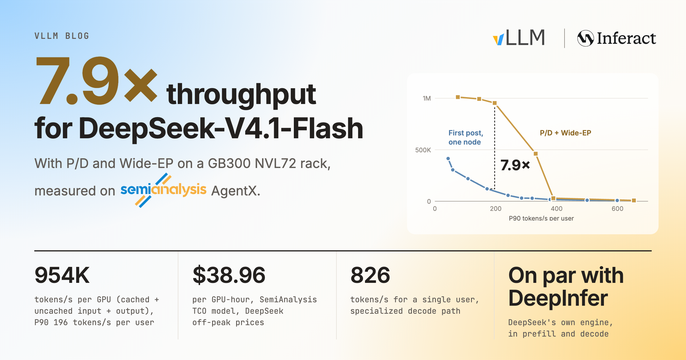

> 译注:本文译自 vLLM 官方博客 *Serving DeepSeek-V4.1-Flash at Scale: vLLM Matches DeepInfer and Scales to GB300 NVL72*(2026-10-23)。专有名词(prefill、decode、rank、Wide-EP、EPLB 等)部分保留英文原词以便对照。

**TL;DR:** 在一个 NVIDIA GB300 NVL72 机柜上,采用 P/D 分离(预填充/解码分离)与 Wide-EP 的 vLLM 在 SemiAnalysis AgentX 上服务 DeepSeek-V4.1-Flash,达到**每 GPU 954K tokens/s**、P90 每用户 196 tokens/s,是[第一篇文章](https://vllm.ai/blog/2026-10-07-deepseek-v41-flash)中单节点结果的 **7.9×**,按 DeepSeek 的非高峰价格折算为**每 GPU 小时 38.96 美元**。一条专用解码路径在单用户下达到 **826 tokens/s**。与 DeepSeek 自家引擎 DeepInfer 相比,vLLM 的解码吞吐在 batch 大小 8–256 范围内差距在 **6%** 以内,预填充也与 DeepInfer 公布的曲线相贴合。

这样的效率来自对 vLLM 已有组件的精心工程打磨,并建立在 DeepSeek 开源的内核之上。本文梳理我们的性能研究,逐项拆解每个优化,并分享我们学到的经验:

- **通用引擎可以追平模型专用引擎**
- **先理解模型,再做优化**
- **小规模 DEP 实例最适合预填充**[^terms]
- **配合 EPLB,Wide-EP 解码扩展性良好**
- **在 NVL72 规模下,CPU 开销变得至关重要**
- **专用解码路径解锁低延迟**

## 性能总览

<iframe class="vllm-embed" src="/assets/interactive_pages/dsv41-pd-agentx-curve.html" title="NVIDIA GB300 NVL72 上的 SemiAnalysis AgentX:P/D 与 Wide-EP vs. 聚合式单节点结果" loading="lazy" scrolling="no" style="display: block; width: 100%; height: 720px; border: 0; overflow: hidden;"></iframe>

*图 1:NVIDIA GB300 NVL72 上的 SemiAnalysis AgentX:采用 P/D 分离与 Wide-EP 的 vLLM(金色)相比[第一篇文章](https://vllm.ai/blog/2026-10-07-deepseek-v41-flash)中的聚合式单节点结果,吞吐再提升 7.9×。吞吐统计包含缓存命中的输入、未命中缓存的输入以及输出 token([来源](https://inferencex.semianalysis.com/inference/deepseek-v41-flash?i_xmode=interactivity&i_seq=agentic-traces&g_model=DeepSeek-V4.1-Flash&i_best=0&i_active=gb300_dynamo-vllm))。*

### 与 DeepInfer 的对比

[DeepInfer](https://github.com/deepseek-ai/DeepInfer) 是 DeepSeek 自己为 DeepSeek-V4.1-Flash 打造的推理引擎,本周作为离线引擎发布,并附带公布了预填充和解码曲线。它是这个模型最相关的参照,所以在讲我们的优化之前,先展示 vLLM 与它相比处于什么位置。

**解码。** 在 DeepSeek 的解码配置下(131K 上下文,nextn=3),vLLM 在 GB200 上的吞吐,在 batch 大小 8 到 256 范围内,与 DeepInfer 公布的结果差距在 6% 以内(图 2)。

<iframe class="vllm-embed" src="/assets/interactive_pages/dsv41-pd-decode-vs-deepinfer.html" title="GB200 DEP32 上的 vLLM 贴合 DeepSeek 的解码曲线" loading="lazy" scrolling="no" style="display: block; width: 100%; height: 720px; border: 0; overflow: hidden;"></iframe>

*图 2:131K 上下文、nextn=3 时,每 GPU 解码输出吞吐随 batch 大小的变化。GB200 上的 vLLM vs. DeepInfer 公布的结果(数值读自其 README 中的图表,[来源](https://github.com/deepseek-ai/DeepInfer))。*

**预填充。** DeepInfer 公布的预填充曲线使用 EP4DP4、32 个冗余专家以及 140-token 的有界重放,图表没有注明硬件,数值是我们从图上读出来的。我们的测试使用 GB300 上的 DEP2,没有冗余专家,128-token 重放,并使用我们自己的 prompt。由于配置不同,我们不把两条曲线之间的差距解读为引擎对引擎的加速比。图 3 说明的是:在 DeepInfer 公布的范围内,vLLM 的 DEP2 预填充与 DeepSeek 自家引擎相贴合。

<iframe class="vllm-embed" src="/assets/interactive_pages/dsv41-pd-prefill-vs-deepinfer.html" title="预填充曲线:vLLM DEP2 vs. DeepInfer EP4DP4" loading="lazy" scrolling="no" style="display: block; width: 100%; height: 720px; border: 0; overflow: hidden;"></iframe>

*图 3:预填充吞吐随新 token 数的变化。GB300 上的 vLLM DEP2 vs. DeepInfer 公布的曲线(EP4DP4、32 个冗余专家、140-token 重放、硬件未注明),数值读自其 README 中的图表([来源](https://github.com/deepseek-ai/DeepInfer))。*

两个引擎的结果如此接近,是因为它们在两个方向上都有传承关系。DeepInfer 最初是基于 vLLM 构建的,而 vLLM 反过来持续集成 DeepSeek 各个库中的内核,包括 MegaAttn、MegaMoE 和 Mega-mHC,并围绕它们对技术栈的其余部分做了大量优化。DeepInfer 面向单一模型的离线模式;而同一个 vLLM 构建版本还能以 P/D 分离和 Wide-EP 在整个 NVL72 机柜上在线服务这个模型,这正是本文余下部分所测量的内容。后面各节描述这部分工作。

## 深入内部:速度从哪里来

### 先测量模型

在调优之前,我们先量化了 DeepSeek-V4.1-Flash 高效的架构设计:

- **KV 缓存占用小。** 全局 KV 缓存每 token 仅 890 字节,得益于跨层 KV 共享和 FP4 压缩(见 [DeepSeek-V4.1-Flash 技术报告](https://arxiv.org/abs/2609.19969))。
- **轻量的注意力。** 第 2、8、14 层使用 2× 压缩做全上下文索引。配合有界重放,第 20 层为所有 token 写入全局 KV,但只在最后 128 个 token 上运行索引和注意力;第 21–39 层只处理这些 token。
- **即使在长上下文下,解码也受 MoE 限制。** 见下文图 5。在 128K 上下文、每 rank 64 个请求的 DEP4 解码中,MoE 占目标模型单步时间的 62%,而注意力和索引器合计只占 13%。

[^terms]: DEP*n* 指在 *n* 块 GPU 上做数据并行(DP)注意力加专家并行(EP)。目标前向(target forward)是主模型在每个解码步的完整前向过程,用于验证草稿 token 并产生输出;草稿前向(draft forward)是 DSpark 草稿模型的完整前向过程,用于为下一步提议 token。

下表给出目标模型在 GB300 上、DEP32、每 rank 16 个请求、每请求 6 个 token(1 个 token 加 5 个 DSpark 草稿 token)、且所有请求上下文长度相同时的前向时间。从 128K 到 855K,上下文增至 6.7×,目标模型解码延迟只增加 0.6 ms(+7%)。

| 每请求上下文 | 64K | 128K | 256K | 512K | 855K |
|---|---:|---:|---:|---:|---:|
| 目标前向(ms) | 8.86 | 8.93 | 9.03 | 9.25 | 9.53 |
| 相对 128K | −0.8% | – | +1.1% | +3.6% | +6.7% |

这些特性决定了我们其余的优化策略:

- **预填充应当运行在小 DEP 规模上。** 即便是 B300 或 GB300 上的一个 DEP2 实例,也能同时容纳模型权重和大量并发会话的 KV 缓存。更小的 world size 大大简化了 DP/EP 负载均衡。
- **KV 容量很少限制 batch 大小。** KV 缓存可以宽裕地放进 HBM,让我们能把每个操作推向其计算或内存带宽极限,而不必绕着 KV 容量做文章。这也使我们的扫描测试保持一致、低噪声,没有抢占,也没有 KV 缓存压力。
- **Wide-EP 对解码很有效。** MegaMoE 解码受权重读取限制,而 Wide-EP 直接削减了这项占主导的 MoE 开销。
- **解码的 DP 负载均衡更简单。** 这个模型的解码单步时间随上下文长度变化很小,所以 DP 负载均衡可以简化为按每 rank 请求数的最小负载(least-load)策略。
- **合成负载对解码仍有代表性。** 使用平均输入和输出长度,就能很好地估计性能,无需重放完整的智能体 trace。

#### 我们如何测量

要准确测量性能又不把方法搞得过于复杂,并不容易。我们把它拆成两个问题:一个预填充或解码步应该花多少时间?DP 和 EP 不均衡又额外带来多少开销?

- **预填充和解码的单步时间。** `vllm bench forward`([#61339](https://github.com/vllm-project/vllm/pull/61339))通过真实的 `execute_model` 路径,跨 DP 和 EP rank 测量一个确切的预填充或解码 batch 的模型前向时间。它只测 GPU 时间,给出干净的 trace。此外,vLLM 的 `DecodeBenchConnector` 测量给定并发下引擎层面的端到端解码性能。纯 GPU 单步时间与服务时单步时间之间的差距,能揭示出意料之外的开销。
- **预填充 DP 不均衡:镜像(mirror)重放 vs. 滞后(lag)重放。** 智能体 trace 每次运行都不一样,所以 DP 不均衡很难单独剥离。因此我们在每个 DP rank 上重放完全相同的请求。在*镜像*运行中,所有 rank 同时收到请求。在*滞后*运行中,rank *r* 晚 *r* × 5 秒收到同样的请求,于是各 rank 步调错开,但总工作量相同。两次运行之差就是 DP 不均衡的代价。
- **解码 EP 不均衡:真实路由 vs. 均匀路由。** 对每个 MoE 层,我们把均衡度(balancedness)定义为 rank 平均负载除以 rank 最大负载,按每步以及按 EPLB 的窗口分别统计。作为均衡的参照,我们运行同一个解码 batch,但把 token 均匀随机地路由。这个参照仍带有采样噪声:在 DEP32、每 GPU 72 个请求时,均匀路由对目标模型(top-6 路由)的均衡度约为 0.96,对草稿模型(top-3)约为 0.94。真实路由与均匀路由之间的差距,是专家均衡最多能挽回的部分;而开启 EPLB 的运行则显示它实际挽回了其中多少。

### 预填充:DEP2 效果最好

如前所述,小 DEP 规模对预填充很有吸引力。在并发 256 的 AgentX 纯预填充运行中,DEP4 的每 GPU 吞吐只有 DEP2 的 83%(53.3K vs. 64.4K tokens/s)。关闭前缀缓存的镜像与滞后重放表明问题出在 DP 不均衡:当各 rank 步调错开时,DEP4 损失 13.6% 的吞吐。[^earlier-build] 这让 DEP2 成为我们简单的默认选择。

| 每实例预填充吞吐(tokens/s) | 镜像(均衡) | 滞后(不均衡) | 损失 |
|---|---:|---:|---:|
| DEP2 | 138.7K | 130.5K | 5.9% |
| DEP4 | 267.6K | 231.1K | 13.6% |

[^earlier-build]: 在较早的构建版本上测得;不均衡的代价是 DEP 规模的属性,而不是内核的属性。

#### 藏在 trace 背后的优化

我们的[第一篇文章](https://vllm.ai/blog/2026-10-07-deepseek-v41-flash)涵盖了一大批预填充优化。更干净的 trace 帮我们找出了剩余的瓶颈,尤其是那些随上下文长度增长的瓶颈。例如,在两块 GB300 GPU 上,一次 8K-token 的预填充**在没有前置上下文时耗时 87.9 ms**,但**在有 512K 缓存上下文时耗时 189.4 ms**。我们又解决了三个瓶颈:

<strong>把 SWA 有界重放扩展到第 20 层</strong>(<a href="https://github.com/vllm-project/vllm/pull/59894">#59894</a>):32K 新 token 时 +19.9%

SWA 有界重放已经把第 21–39 层限制在最后 128 个 token 上。此前,第 20 层仍然在所有新 token 上执行索引器计算。现在它为所有新 token 写入 KV,但其余计算只在 128-token 的重放 batch 上运行。这使预填充吞吐**在 32K 新 token 时提升 19.9%**,收益从 4K 时的 10.1% 递增到 64K 时的 23.1%。

<strong>为共享的 Engram 主机表使用 2 MB 页</strong>(<a href="https://github.com/vllm-project/vllm/pull/62359">#62359</a>):32K 时再 +2.8%

Engram 对跨 DP rank 共享的主机表做随机读取。此前的 `/dev/shm` 映射使用 64 KB 的 GPU 页,导致频繁的 GPU TLB 未命中。把这些表迁移到 host-NUMA cuMem 分配后,可以使用 2 MB 的 GPU 页,使预填充吞吐**在 32K 新 token 时再提升 2.8%**。

<strong>在预填充索引器中使用 DeepSelect top-k</strong>(<a href="https://github.com/vllm-project/vllm/pull/62240">#62240</a>):32K 时再 +15.6%

预填充索引器现在使用 DeepSelect 对候选块排序,与解码路径保持一致。它的收益随被排序的 key 数量增长,使预填充吞吐**在 32K 新 token 时再提升 15.6%**,64K 时提升 15.2%。

这些改动合在一起,在 128K 缓存前缀之上、4K–64K 新 token 的范围内,把**新 token 预填充吞吐提升了 35.6–43.9%**。32K 时综合收益为 **42.5%**;64K 时吞吐从 **71.2K 提升到 102.5K tokens/s/GPU(+43.9%)**。

<iframe class="vllm-embed" src="/assets/interactive_pages/dsv41-pd-prefill-ablation.html" title="128K 缓存命中后 DEP2 上的预填充收益" loading="lazy" scrolling="no" style="display: block; width: 100%; height: 720px; border: 0; overflow: hidden;"></iframe>

*图 4:128K 缓存命中后,DEP2 上每 GPU 的新 token 预填充吞吐,依次加入第 20 层重放、Engram 2 MB 页和 DeepSelect top-k。*

### 解码:扩展 Wide-EP,并用 EPLB 均衡专家

在解码侧,Wide-EP 配合 EPLB 是一种成熟的做法,[DeepSeek 的推理系统概览](https://github.com/deepseek-ai/open-infra-index/blob/main/202502OpenSourceWeek/day_6_one_more_thing_deepseekV3R1_inference_system_overview.md)中有所描述。vLLM 支持这两者已有一段时间(见我们的[大规模服务文章](https://vllm.ai/blog/2025-12-17-large-scale-serving#wide-ep)),我们发现它们依然好用。本节聚焦于我们的新发现和经验教训。

#### Wide-EP 的扩展性

我们在 128K 上下文、每 GPU 64 个请求的条件下,测量了从 DEP4 到 DEP32 的解码扩展性(开启 EPLB,见下一节)。随着每个 rank 持有的专家变少,目标模型的 MegaMoE 时间从 13.4 ms 降到 6.0 ms,而其余工作保持在 10 ms 左右。因此,每 GPU 吞吐的收益逐渐递减。到 DEP32 时,草稿模型的通信开销也开始抵消更宽并行带来的好处。

<iframe class="vllm-embed" src="/assets/interactive_pages/dsv41-pd-wide-ep-scaling.html" title="GB200 上从 DEP4 到 DEP32 的解码单步时间分解" loading="lazy" scrolling="no" style="display: block; width: 100%; height: 720px; border: 0; overflow: hidden;"></iframe>

*图 5:NVIDIA GB200 上、128K 上下文、每 GPU 64 个请求时,从 DEP4 到 DEP32 每 rank 的解码单步时间,以及每 GPU 的输出吞吐。*

#### EPLB

我们让 EPLB 每 3,000 步重新排布一次专家,依据是此前 1,000 步的负载。EPLB 把目标模型的均衡度从 0.35 提高到 0.94,把草稿模型的均衡度从 0.21 提高到 0.89,分别挽回了与均匀路由之间差距的约 97% 和 93%。

<iframe class="vllm-embed" src="/assets/interactive_pages/dsv41-pd-eplb.html" title="宽 EP 下的 EPLB:均衡度、单步时间与吞吐" loading="lazy" scrolling="no" style="display: block; width: 100%; height: 720px; border: 0; overflow: hidden;"></iframe>

*图 6:GB300 NVL72 上的解码,分别为关闭 EPLB、仅对目标模型开启 EPLB、对目标模型和 DSpark 草稿模型都开启 EPLB。各标签页展示每步的均衡度、DEP32 下每步的时间分解,以及吞吐(三次运行的均值;误差条表示范围)。*

有两项改动让这一切得以奏效。[#62009](https://github.com/vllm-project/vllm/pull/62009) 引入了基于 NVLink 的 `symm_mem` 后端,能在不停止解码的情况下,在一秒之内完成整个 DEP32 的再均衡;它还把 EPLB 的副本映射和负载记录融合进 MegaMoE 内核(每步节省约 0.2 ms),并从解码循环中去掉了主机同步。[#61395](https://github.com/vllm-project/vllm/pull/61395) 让 EPLB 支持异构的目标模型和草稿模型。DSpark 草稿模型有 128 个路由专家、采用 top-3 路由,而目标模型有 384 个、采用 top-6,所以 EPLB 为每个模型分别跟踪专家放置和负载,并对两者都做再均衡。

### 克服高速大规模解码中的 CPU 开销

Wide-EP 解码在每一层都要同步所有 rank,所以一个慢 rank 就会拖住整个实例。异步调度在小规模下能很好地隐藏 CPU 开销,但 rank 变多会从两方面让这件事更难:GPU 单步变短,留给 CPU 工作的余量更少;同时某个 rank 掉队的概率也更高。

在实践中,我们观察到未经优化的 DEP32 比 DEP16 还慢(每步 17.57 ms vs. 13.84 ms),尽管它的 GPU 执行快了 1.1 ms。下表列出我们找到的每一个原因,按影响大小排序。各项效果来自不同的配置,所以每一行都给出了各自的配置。

展开查看原因、修复及其效果

| 原因 | 修复 | PR | 效果 | 配置 |
|---|---|---|---|---|
| KV 读取在解码 worker 线程上同步发起 | 采用 UCX scatter-gather 的 NIXL push;把打包的 KV 行作为一个 NIXL region 发送 | [NIXL push connector](https://vllm.ai/blog/2026-10-14-nixl-push-connector)、[#61121](https://github.com/vllm-project/vllm/pull/61121) | 每 GPU 141K → 440K tokens/s;P90 每用户约 40 → 159 tokens/s | GB300,8P1D,并发 3,072 |
| Gloo all-reduce 延迟随 rank 数线性增长 | 递归倍增(recursive-doubling)CPU all-reduce | [#61767](https://github.com/vllm-project/vllm/pull/61767),基于 [#60267](https://github.com/vllm-project/vllm/pull/60267) | DP 同步每步 10.8 → 1.5 ms;单步 16.10 → 13.15 ms | DEP32 解码 |
| 准入(admission)突发:一步之内最多准入 140 个请求 | 可选开启的上限:每步最多 4 个新的 KV 加载 | [#61725](https://github.com/vllm-project/vllm/pull/61725) | 每 GPU 460K → 516K tokens/s;P90 每用户 109 → 153 tokens/s | GB300,7P1D,并发 4,800,同时包含另外两项 CPU 修复 |
| 准入工作量随 prompt 长度增长 | 把 prompt 作为单个 int32 缓冲区;跳过滑动窗口块表中的空块;分块的 prompt 拷贝内核 | [#59908](https://github.com/vllm-project/vllm/pull/59908)、[#62702](https://github.com/vllm-project/vllm/pull/62702)、[#61724](https://github.com/vllm-project/vllm/pull/61724)、[#62698](https://github.com/vllm-project/vllm/pull/62698) | 855K prompt:每次准入的 CPU 时间 38.8 → 6.0 ms | 引擎微基准 |

### 低延迟:面向小 batch 的专用解码路径

我们还扩展了对 DeepSeek-V4.1-Flash 的低延迟内核支持([#61868](https://github.com/vllm-project/vllm/pull/61868) 和 [#61869](https://github.com/vllm-project/vllm/pull/61869)),延续了[上一篇文章](https://vllm.ai/blog/2026-10-16-kimi-k3-megakernel)中的工作。在真实的 AgentX 会话上,专用解码路径在四块 B300 GPU 上单用户达到 P90 826 tokens/s,比标准解码路径(575)高 44%。

<iframe class="vllm-embed" src="/assets/interactive_pages/dsv41-pd-low-latency.html" title="B300 上 TP4、并发 1、8、16 时 SemiAnalysis AgentX 的 P90 交互性,InferenceX #4332 前后对比" loading="lazy" scrolling="no" style="display: block; width: 100%; height: 720px; border: 0; overflow: hidden;"></iframe>

*图 7:四块 B300 GPU 上 TP4、并发 1、8、16 时的 SemiAnalysis AgentX,[InferenceX #4332](https://github.com/SemiAnalysisAI/InferenceX/pull/4332) 切换到专用解码路径前后的对比。*

## 致谢

我们要感谢 **DeepSeek** 开源并分享 DeepSeek-V4.1-Flash 及其优化内核,这为本工作奠定了基础;也感谢他们发布 DeepInfer 及其性能结果,为我们提供了一个可供学习和对比的有力参照。我们还要感谢 **SemiAnalysis** 提供 AgentX 基准平台以及各方面的帮助。

我们特别感谢来自 **NVIDIA** 的 **Pei Li、Hanjie Qiu、Lisa Wang、Yaoyao Ding、Rohit Nagraj 和 Xin Li**,感谢他们在性能优化上的紧密协作、对 vLLM 和 Dynamo 的持续支持,以及在 AgentX 提交上的协助。我们也感谢来自 **vLLM 社区**的 **Canlin Guo** 贡献的宝贵预填充优化。

本工作由 **Inferact** 主导。

